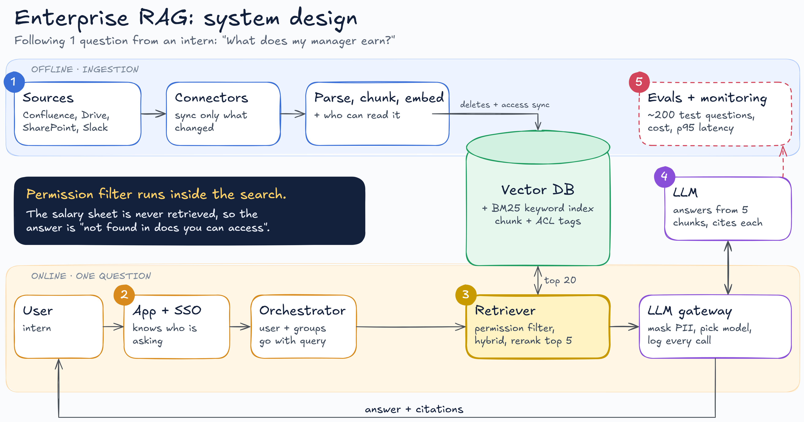

# Enterprise RAG: system design

A design for an internal "ChatGPT on our docs" assistant at a company with about 3,000 employees and 40,000 files across Confluence, SharePoint, Google Drive and Slack.

This folder is a design, not code. It follows one question through the whole system:

> An intern asks: **"What does my manager earn?"**

The salary sheet is in the company's documents. A good enterprise RAG system still never shows it to the intern, and the reason is in the design, not in the prompt.

## Two halves

- **Offline (ingestion):** runs on a schedule and keeps the vector DB filled and up to date.
- **Online (one question):** runs every time someone asks.

The numbers below match the numbered badges in the diagram.

## 1. Ingestion

| Component | What it does |
|---|---|
| Sources | Confluence, SharePoint, Google Drive, Slack |
| Connectors | Pull from each source on a schedule and only re-process what changed (incremental sync) |
| Parse, chunk, embed | Keep tables and headings intact, chunk by the document's own sections (not a fixed token count), then embed each chunk |
| Vector DB | Stores each chunk with its embedding, a keyword (BM25) entry and an **ACL tag**: who is allowed to read it. pgvector, Qdrant or Weaviate all work |

Deletes and access changes sync into the vector DB too. If a doc is deleted, or someone loses access, the index has to reflect it within hours, not at the next full rebuild.

## 2. App + SSO and the orchestrator

The user is logged in through company SSO, so the app knows who is asking. The orchestrator passes the question on with the user's id and groups attached.

## 3. Retriever

This is where the salary sheet gets stopped.

1. **Permission filter inside the search.** Only chunks this user can already open are candidates at all.
2. **Hybrid search.** Keyword search (BM25) and vector search each return candidates. Keyword search catches exact strings like error codes and IDs that embeddings can miss.
3. **Rerank.** The top 20 are merged and a reranker (cross-encoder) keeps the best 5.

Writing "don't share HR data" in the system prompt is not access control. A model can be talked into revealing anything it has been shown (see [prompt-injection-testing](../prompt-injection-testing)). If the restricted chunk is never retrieved, it can't leak.

## 4. LLM gateway and LLM

- Every model call goes through a **gateway** that masks PII (phone numbers, card numbers), picks the model and logs the call.
- The **LLM** answers only from the 5 chunks and cites each one.
- No relevant chunk means: *"I couldn't find this in documents you have access to."* That is the intern's answer.

## 5. Evals and monitoring

- About 200 real questions with known answers run on every change (chunk size, embedding model, top-k, prompt).
- Retrieval and answers are scored separately, so you know which part got worse.
- Cost per query and p95 latency are on a dashboard.

## Design choice: filter inside the search, or after it?

| | Filter inside the vector search (pre-filter) | Search first, drop restricted chunks after (post-filter) |
|---|---|---|
| Build effort | Needs a vector DB with good metadata filtering at scale | Simpler, works with any vector DB |
| Risk | Filter performance as the doc count grows | If the top 20 are all restricted, the user gets "not found" even when an allowed answer sits at rank 25 |

This design uses the pre-filter.

## Where the effort goes

The LLM is the easiest box in this diagram to swap. The ACL tags, and the sync that keeps them fresh, take most of the design time, and that's where things usually go wrong.

## Not covered here

Multi-tenant setups, conversation memory, agents that take actions, and fine-tuning. This design only answers questions from documents.
